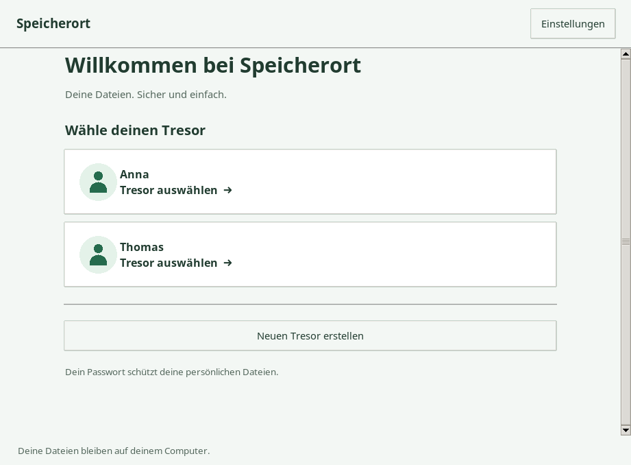

# Speicherort · MintTresor

**Deine Dateien. Sicher und einfach.**

Speicherort ist eine deutsche Desktop-Anwendung für Linux Mint. Deine persönlichen Dateien liegen in einem verschlüsselten Tresor auf deinem Computer. Du wählst deinen Namen, gibst dein Passwort ein und öffnest deine Dateien im gewohnten Dateimanager.

Das Projekt heißt intern weiterhin **MintTresor**. Befehle, Kontodaten und vorhandene Tresore bleiben kompatibel. Version **0.3.0** erneuert die Oberfläche; Verschlüsselungsverfahren und Systemfreigaben bleiben erhalten.



## Installieren

1. **VeraCrypt installieren:** Lade das passende Linux-Paket von der [offiziellen Downloadseite](https://veracrypt.io/en/Downloads.html). Für Linux Mint 22.x passt üblicherweise Ubuntu 24.04, für Mint 21.x Ubuntu 22.04. LMDE benötigt das entsprechende Debian-Paket. Installiere das Paket durch Doppelklick mit der Paketverwaltung. Die grafische VeraCrypt-Version hilft bei einer späteren Wiederherstellung.
2. **Dieses Projekt herunterladen:** Öffne auf GitHub **Code → Download ZIP** und entpacke das Archiv. Für eine bestimmte veröffentlichte Version kannst du das Quellarchiv unter **Releases** verwenden.
3. Klicke im entpackten Ordner mit der rechten Maustaste und wähle **Im Terminal öffnen**. Gib ein:

   ```bash
   bash install.sh
   ```

4. Lass einmalig die unten beschriebene **Gastfreigabe durch einen Administrator** einrichten.
5. Starte **Speicherort** über das Linux-Anwendungsmenü.

Das Installationsskript installiert fehlendes `python3-tk` über die Paketverwaltung; dafür fragt Linux nach dem Systempasswort. Die Anwendung selbst läuft als normaler Benutzer. Nach einem Update `bash install.sh` erneut ausführen. Bestehende Konten, gespeicherte Einstellungen und Tresore werden nicht zurückgesetzt.

Benötigt werden Python ab 3.10, Tkinter ab Tk 8.6, VeraCrypt unter `/usr/bin/veracrypt` mit `--stdin`-Unterstützung (Integration mit Version 1.26.31), `xdg-open` und `sudo`. Es gibt keine zusätzlichen Python-Abhängigkeiten.

## Deinen ersten Tresor erstellen

Wähle auf der Startseite **Neuen Tresor erstellen**. Der Assistent führt dich durch vier Schritte:

1. **Name:** Wähle zum Beispiel deinen Vornamen. Dieser Name erscheint später auf der Startseite. Er darf 1 bis 40 Zeichen lang sein.
2. **Passwort:** Gib ein Passwort mit mindestens 12 Zeichen zweimal ein. Mehrere Wörter sind oft gut zu merken. **Bewahre das Passwort sicher auf: Ein vergessenes Passwort kann nicht zurückgesetzt werden.**
3. **Einrichtung:** Wähle die Größe. Voreingestellt sind 2 GB; möglich sind 1 bis 32 GB (technisch GiB). Der angezeigte Speicherort gilt für diesen neuen Tresor. **Tresor erstellen** beginnt die Verschlüsselung. Das dauert je nach Laufwerk einige Minuten; eine Fortschrittsanzeige bleibt sichtbar. Die Größe lässt sich später nicht automatisch erweitern. Eine einzelne Datei muss kleiner als 4 GB sein.
4. **Fertig:** Wähle **Jetzt Dateien öffnen**, gib dein Passwort ein und dein Dateimanager wird gestartet. Aus Sicherheitsgründen bewahrt der Assistent dein Passwort nach der Erstellung nicht auf.

Mit **Zurück** kannst du Angaben ändern. Wenn du zum Passwortschritt zurückkehrst oder eine Erstellung fehlschlägt, gib das Passwort erneut ein. Während der tatsächlichen Erstellung lässt sich der Vorgang nicht über die Oberfläche abbrechen.

## Deine Dateien öffnen

1. Starte **Speicherort** und klicke auf die Karte mit deinem Namen.
2. Gib dein Passwort ein und klicke auf **Tresor öffnen**. Die Eingabetaste funktioniert ebenfalls.
3. Klicke auf **Meine Dateien öffnen**. Dort kannst du Dokumente, Bilder und andere Dateien ablegen oder bearbeiten.

Es ist keine Online-Anmeldung nötig. Nach einmaliger Gastfreigabe brauchst du nur dein persönliches Tresorpasswort, kein Adminpasswort.

Mit **Passwort anzeigen** kannst du deine Eingabe kurz prüfen. Nach zehn Sekunden, beim Verlassen der Passwortbedienelemente, beim Wechsel in ein anderes Fenster oder mit **Escape** wird sie wieder verdeckt. Beim Wechsel der Ansicht und vor dem Öffnen werden die Eingabefelder geleert.

## Deinen Tresor sicher schließen

Speichere deine Dokumente. Schließe die Programme und Ordnerfenster, die Dateien im Tresor verwenden. Klicke danach auf **Tresor sicher schließen**. Erst die Anzeige **Dein Tresor ist geschlossen** bestätigt das Schließen.

Falls das Schließen nicht klappt, bleibt die Anwendung geöffnet und zeigt eine Handlungsempfehlung. Schließe noch verwendete Dokumente und versuche es erneut. Es wird kein erzwungenes Schließen verwendet.

Wenn du das Anwendungsfenster mit geöffnetem Tresor schließt, wirst du daran erinnert, deine Dokumente zu speichern. Nach deiner Bestätigung schließt Speicherort zuerst den Tresor. Bei einem Fehler bleibt das Fenster offen. Du kannst den Dialog auch abbrechen und weiterarbeiten.

Nach einem Absturz oder Stromausfall kann ein Tresor geöffnet bleiben. Starte Speicherort erneut. Seine Karte zeigt **Noch geöffnet**. Melde dich an und schließe den Tresor sicher. Andere noch geöffnete bekannte Tresore verhindern ebenfalls das normale Beenden.

## Mit LibreOffice arbeiten

Öffne **Meine Dateien öffnen**. Ziehe Dateien in diesen Ordner oder wähle ihn in LibreOffice unter **Speichern unter**. Deine Dateien lassen sich mit den üblichen Programmen bearbeiten.

LibreOffice kann Sicherungen, Wiederherstellungsdaten und temporäre Dateien außerhalb des Tresors anlegen. Prüfe für vertrauliche Arbeit dessen Einstellungen für Backups, AutoWiederherstellung und temporäre Pfade. Speicherort ändert diese Programmeinstellungen nicht.

## Einstellungen und einmalige Administratorfreigabe

Unter **Einstellungen** kannst du einen **Ordner für neue Tresore** wählen. Ohne Änderung gilt `~/Tresore`. Das verschiebt oder verändert bestehende Tresore nicht. Der Ordner muss beschreibbar sein. Für das Öffnen eines Tresors muss sein Speicherort zusätzlich vom Systemhelfer freigegeben sein; die Auswahl eines Ordners erteilt diese Berechtigung nicht.

Technische Einrichtungshinweise liegen hinter **Einrichtung durch Administratoren anzeigen**. Zum normalen Öffnen und Schließen sind sie nicht nötig.

Ein Administrator führt im entpackten Projektordner einmalig aus:

```bash
sudo bash setup-guests.sh LINUX-BENUTZER
```

`LINUX-BENUTZER` ist das Linux-Konto, in dem Speicherort läuft, **nicht** der Name einer Tresorkarte. `whoami` zeigt den Namen des aktuellen Linux-Kontos. Bei einem gemeinsam genutzten Konto genügt eine Freigabe für dieses Konto.

Dabei wird das Heimatverzeichnis dieses Linux-Kontos freigegeben. Für externe Laufwerke zusätzliche bestehende Ordner ausdrücklich angeben:

```bash
sudo bash setup-guests.sh gast /media/gast/Datentraeger/Tresore
```

Bei erneutem Aufruf werden die Zusatzordner durch die dann angegebenen ersetzt. Bereits eingerichtete andere Linux-Konten bleiben erhalten. Installiere die Anwendung anschließend mit `bash install.sh` im Gastkonto. Nach einer neuen VeraCrypt-Installation Speicherort neu starten.

Die Freigabe benötigt einmal Adminrechte. Im Alltag verwendet Speicherort ausschließlich `sudo -n`; ohne Freigabe gibt es eine Fehlermeldung ohne interaktive Adminabfrage. Einstellungen und ausgeblendete Hinweise ersetzen keine Zugriffskontrolle: Der root-eigene Systemhelfer prüft die Berechtigung bei jedem Öffnen und Schließen.

**Update von 0.1.x:** Zuerst alle geöffneten Tresore mit der alten Version schließen, Gastfreigabe einrichten und `bash install.sh` erneut ausführen. Nur die temporären Öffnungsordner wechseln nach `/run/minttresor`. Beim Update von 0.2.x bleiben Kontodaten, Tresordateien, Pfade und bereits eingerichtete Gastfreigaben unverändert verwendbar.

## Bedienung mit der Tastatur und große Schrift

Mit **Tab** gelangst du zur nächsten Aktion, mit **Umschalt + Tab** zurück. Der Fokus ist sichtbar. Die **Leertaste** betätigt Schaltflächen und Auswahlkästchen; **Enter** startet im Eingabefeld die Hauptaktion oder betätigt die fokussierte Schaltfläche. Das Passwortfeld erhält nach der Tresorauswahl automatisch den Fokus.

Texte passen sich an die Fensterbreite an. Bei kleinen Fenstern oder hoher Skalierung kannst du mit Mausrad oder Scrollleiste nach unten gehen; bei Tastaturnavigation wird das fokussierte Bedienelement in den sichtbaren Bereich gescrollt. Zustände werden mit Text und Symbolen beschrieben. Die Oberfläche wurde unter Xvfb bei 1366 × 768 und 1920 × 1080 sowie mit 100–200 % Schrift-/DPI-Skalierung geprüft. Eine Prüfung mit Screenreader/AT-SPI auf Linux Mint steht noch aus; vollständige Screenreader-Unterstützung wird nicht zugesichert.

## Datensicherung und Wiederherstellung

1. Schließe alle Tresore.
2. Sichere die `.hc`-Dateien und den gesamten Ordner `~/.local/share/minttresor` auf ein anderes Laufwerk. Behandle auch die Kontodaten vertraulich.
3. Bewahre Passwörter getrennt und sicher auf.

Unter **Hinweise und Tresordetails anzeigen** findest du den gespeicherten Pfad deines Tresors. Eine Tresordatei lässt sich mit ihrem Passwort auch unabhängig von Speicherort in VeraCrypt öffnen. Nach Verlust der Kontodaten gibt es keinen Importassistenten. Beim Wiederherstellen der Kontodaten müssen die gespeicherten absoluten Pfade stimmen; bei einem Rechnerwechsel ist die direkte Verwendung von VeraCrypt oft einfacher.

Eine fehlgeschlagene Erstellung kann eine unvollständige `.hc`-Datei hinterlassen. Diese wird nicht automatisch gelöscht oder überschrieben. Erst nach Prüfung manuell entfernen; eine fehlgeschlagene Kontoanlage speichert keinen neuen Benutzer.

## Technische Daten und Sicherheitsgrenzen

| Inhalt | Ort |
| --- | --- |
| Verschlüsselte Tresordateien | Gewählter Ordner, jeweils `<zufällige Kennung>.hc` |
| Kontodaten und gespeicherte Pfade | `~/.local/share/minttresor/accounts.sqlite3` |
| Geöffnete Ordner | `/run/minttresor/<Linux-UID>/<Kennung>` |
| Anwendung und Starter | `~/.local/lib/minttresor`, `~/.local/bin/minttresor` |
| Menüeintrag | `~/.local/share/applications/minttresor.desktop` (sichtbarer Name: Speicherort) |

Die Kontodaten enthalten Namen und Pfade im Klartext sowie gesalzene scrypt-Prüfwerte, keine Klartextpasswörter. Die Parameter bleiben **scrypt N=131072, r=8, p=1, 16-Byte-Salts**. Passwörter benötigen mindestens 12 Zeichen und dürfen maximal 128 UTF-8-Bytes umfassen; Zeilenumbrüche und Nullzeichen sind ausgeschlossen. Passwörter werden über eine Pipe übergeben, nicht als Kommandozeilenargument, Umgebungsvariable oder Datei. Prozessausgaben werden nicht als Fehlertext weitergereicht oder protokolliert. Python garantiert kein vollständiges Löschen von Passwörtern aus dem Arbeitsspeicher.

VeraCrypt verwendet weiterhin **AES, SHA-512, PIM 0, FAT und `/dev/urandom`**. Der eingeschränkte Systemhelfer bleibt unverändert. Kein Server, keine Telemetrie und kein Hintergrunddienst. Nur die ausdrücklich angeklickte Downloadseite öffnet einen Browser.

`setup-guests.sh` installiert den root-eigenen Helfer `/usr/local/libexec/minttresor-helper`, die Konfiguration `/etc/minttresor/<UID>.json` und eine mit `visudo` geprüfte Regel `/etc/sudoers.d/minttresor-<UID>`. Ausschließlich dieser Helfer ist ohne Kommandozeilenargumente freigegeben. Es gibt keine pauschale Freigabe für VeraCrypt, Python oder eine Shell.

Der Helfer nutzt isoliertes System-Python (`-I`) und keinen Code aus dem beschreibbaren App-Ordner. Er prüft Linux-UID, erlaubte Speicherbereiche, Tresorkennung und Dateibesitz. Symlinks, Hardlinks, Gerätedateien und frei vorgegebene Befehle werden abgelehnt. Er hält die geprüfte Datei über einen Dateideskriptor fest und verwendet root-eigene Öffnungsordner. FAT wird mit `nodev,nosuid,noexec` und den Rechten des aufrufenden Kontos geöffnet. Es gibt kein erzwungenes Aushängen. Die Freigabe erlaubt den Helfer auch außerhalb der Oberfläche; zum Entschlüsseln ist weiterhin das Tresorpasswort nötig.

Weitere Grenzen:

- FAT erlaubt keine Einzeldateien ab 4 GiB. Es gibt keine automatische Vergrößerung.
- Tresorkonten innerhalb eines Linux-Kontos trennen bereits geöffnete Dateien nicht gegenüber anderen Programmen desselben Linux-Benutzers. Für Personen mit unterschiedlichen Zugriffsrechten eigene Linux-Konten verwenden.
- Ein geöffneter Tresor ist für den berechtigten Linux-Benutzer lesbar. Administratoren, Schadsoftware und bereits entsperrte Sitzungen werden dadurch nicht abgewehrt.
- Es gibt keine gemeinsamen Tresore, Passwortänderung, Benutzerlöschung, automatische Sperre, Passwortwiederherstellung oder Verwaltung fremder VeraCrypt-Dateien in der Oberfläche.
- Ein erzwungenes Beenden, Absturz oder Stromausfall garantiert kein sicheres Schließen.

## Entwicklung, Tests und Screenshots

Ohne Installation in einer grafischen Linux-Sitzung starten:

```bash
python3 -m minttresor
```

Auch `python3 minttresor/app.py`, ein absoluter Dateipfad und `python3 -m minttresor.app` funktionieren. Bei fehlender Oberfläche `sudo apt install python3-tk` ausführen. Die internen Startbefehle behalten ihren Namen.

Automatisierte Tests:

```bash
python3 -m unittest discover -s tests -v
```

Für vollständige GUI-Tests auf einem System ohne Desktop:

```bash
sudo apt install xvfb python3-tk
xvfb-run -a -s '-screen 0 1366x768x24' python3 -m unittest discover -s tests -v
```

Ohne `DISPLAY` werden GUI-Tests ausdrücklich übersprungen. Die UI-Tests verwenden eine echte temporäre Kontodatenbank und einen simulierten VeraCrypt-Adapter. Sie prüfen Navigation, Tastatur, Passworteingabe, Assistent, Hintergrundarbeit, Fehler und sicheres Beenden, nicht die tatsächliche Verschlüsselung. Backend- und Helfertests prüfen unter anderem unveränderte Parameter, Dateirechte, Pfadgrenzen und das Vermeiden sensibler Prozessausgaben.

Der CI-Job `guest-integration` installiert VeraCrypt 1.26.31 mit fest geprüftem SHA-256, richtet ein Linux-Testkonto ohne allgemeine sudo-Rechte ein und führt einen **echten** Roundtrip aus: erstellen, falsches Passwort ablehnen, öffnen, Datei schreiben, schließen, erneut öffnen und Inhalt lesen. Ein Linux-Mint-Praxistest mit LibreOffice und Screenreader bleibt separat erforderlich.

Das optionale Screenshot-Werkzeug benötigt Pillow nur in der Entwicklungsumgebung:

```bash
sudo apt install python3-pil
xvfb-run -a -s '-screen 0 1920x1080x24' python3 tests/capture_ui.py --output /tmp/speicherort-bilder
```

Alle Aufnahmen verwenden erfundene Testkonten und einen simulierten Adapter. Sie sind keine Nachweise echter Verschlüsselung. Screenshots und der Umfang der ausgeführten Prüfungen stehen im [Prüfbericht](docs/UX-REPORT.md).

## Deinstallation

Zuerst alle Tresore schließen. Entferne danach `~/.local/lib/minttresor`, `~/.local/bin/minttresor` und `~/.local/share/applications/minttresor.desktop`. Tresore und Kontodaten bleiben absichtlich erhalten.

Ein Administrator kann zusätzlich `/etc/sudoers.d/minttresor-<UID>` und `/etc/minttresor/<UID>.json` für das betreffende Konto entfernen. Wenn kein Konto den Helfer mehr verwendet, auch `/usr/local/libexec/minttresor-helper` entfernen. Nach Änderungen am Helfer die Gastfreigabe mit dem aktuellen Skript erneut installieren.

## Lizenz

GNU GPL Version 3, siehe [LICENSE](LICENSE). Eigenständiges Projekt; nicht mit VeraCrypt oder Linux Mint verbunden. VeraCrypt ist eine separat zu installierende Anwendung mit eigener Lizenz.
