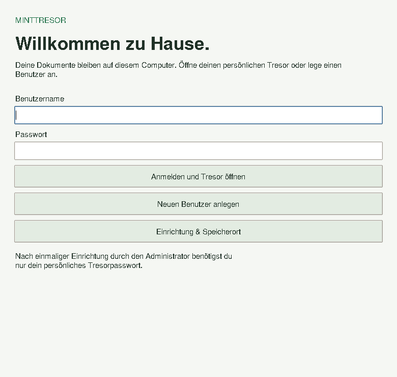

# MintTresor

**Eine einfache, lokale Dateiablage mit persönlichen VeraCrypt-Tresoren für Linux Mint.**

Deutsche Desktopoberfläche · lokale Benutzerkonten · frei wählbarer Speicherort · Ordnerzugriff für LibreOffice und andere Programme.

> Version 0.1.0 ist eine erste, überprüfbare Vorabversion. Die Containererstellung wurde mit echtem VeraCrypt 1.26.31 getestet. Ein vollständiger Test von Systemfreigabe, Einhängen, LibreOffice und Aushängen auf einem Linux-Mint-Desktop steht noch aus.



## Für Einsteiger: installieren

1. **VeraCrypt installieren:** Auf der [offiziellen Downloadseite](https://veracrypt.io/en/Downloads.html) das passende Linux-Paket herunterladen. Für Linux Mint 22.x passt üblicherweise das Ubuntu-24.04-Paket, für Mint 21.x Ubuntu 22.04. LMDE benötigt das passende Debian-Paket. Das Paket durch Doppelklick mit der Paketverwaltung installieren. Die grafische VeraCrypt-Version erleichtert auch die spätere Wiederherstellung.
2. **MintTresor herunterladen:** Bei GitHub unter **Releases** das ZIP der aktuellen Vorabversion laden und entpacken.
3. Im entpackten Ordner mit der rechten Maustaste **„Im Terminal öffnen“** wählen und ausführen:

   ```bash
   bash install.sh
   ```

4. **MintTresor** im Linux-Anwendungsmenü starten. Fehlendes `python3-tk` installiert das Skript über die Paketverwaltung; dafür wird das Linux-Systempasswort benötigt. MintTresor selbst läuft als normaler Benutzer.

Voraussetzungen: Python 3.10 oder neuer, Tkinter, VeraCrypt mit `--stdin`-Unterstützung (geprüft mit 1.26.31), `xdg-open` und `pkexec` samt grafischem Polkit-Authentifizierungsagenten. Auf Mint Cinnamon ist ein Agent normalerweise vorhanden. Falls `pkexec` fehlt: `sudo apt install policykit-1`; je nach Distribution heißt das Paket `polkitd-pkexec`.

## In drei Schritten einrichten

1. **Einrichtung & Speicherort:** Einen Standardordner wählen, zum Beispiel `Dokumente/Tresore` oder einen Ordner auf einer externen Festplatte. Ohne Änderung gilt `~/Tresore`.
2. **Neuen Benutzer anlegen:** Benutzername, Passwort und Wiederholung eingeben. Die Größe ist auf 2 GB voreingestellt, wählbar sind 1–32 GiB. Der gesamte Container wird angelegt und verschlüsselt; dies dauert je nach Laufwerk einige Minuten. Das Passwort benötigt mindestens 12 Zeichen. Es gibt keine E-Mail, Cloud und Passwortzurücksetzung.
3. **Anmelden und Tresor öffnen:** Linux fragt für das Einhängen zusätzlich nach der Systemberechtigung. Dies ist das Linux-Systempasswort und gegebenenfalls ein anderes Passwort als das des Tresors.

Der Standardordner gilt für **neu angelegte** Tresore. Bestehende Tresore werden beim Ändern dieser Einstellung nicht verschoben.

## Mit LibreOffice arbeiten

**Meinen Ordner öffnen** anklicken. Dateien hineinlegen oder in LibreOffice unter **Speichern unter** diesen geöffneten Ordner wählen. Auch Bilder, PDFs und andere Dateien funktionieren über den normalen Dateimanager.

Vor **Tresor schließen und abmelden** alle Dokumente speichern, Programme mit Dateien im Tresor und die zugehörigen Dateimanagerfenster schließen. Bei belegtem Tresor bricht MintTresor ab; es erzwingt kein Aushängen. Auch das Schließen des App-Fensters hängt den aktuell verwendeten Tresor zuerst aus. Nach einem Absturz können Tresore geöffnet bleiben: erneut anmelden und schließen. Die Startseite zeigt bekannte noch eingehängte Tresore an.

### Grenzen dieser ersten Version

- FAT als internes Dateisystem: **eine einzelne Datei muss kleiner als 4 GiB sein**. Geeignet für gewöhnliche Office-Dateien, weniger für große Videos oder virtuelle Maschinen. Containergröße 1–32 GiB, keine automatische Erweiterung.
- Lokale App-Konten innerhalb **eines Linux-Benutzerkontos**. Sie bieten individuelle verschlüsselte Ablagen, aber keine Trennung bereits geöffneter Tresore gegenüber anderen Programmen desselben Linux-Benutzers. Für unabhängige Personen mit unterschiedlichen Zugriffsrechten eigene Linux-Konten verwenden.
- Ein geöffneter Tresor ist für den berechtigten Linux-Benutzer lesbar. Administratoren, Schadsoftware und bereits entsperrte Sitzungen werden dadurch nicht abgewehrt.
- LibreOffice kann Sicherungen, Wiederherstellungsdaten und temporäre Dateien außerhalb des Tresors anlegen. Für vertrauliche Arbeit die Office-Einstellungen für Backups, AutoWiederherstellung und temporäre Pfade prüfen. MintTresor verwaltet diese Programmeinstellungen nicht.
- Keine gemeinsamen Tresore, Passwortänderung, Benutzerlöschung, automatische Sperre, Wiederherstellungsfunktion oder Verwaltung vorhandener fremder VeraCrypt-Container in der Oberfläche. VeraCrypt selbst kann die erzeugten Container öffnen.
- Bei Stromausfall und erzwungenem Beenden ist ein geöffneter Tresor nicht automatisch sicher geschlossen.

## Wo liegen die Daten?

| Inhalt | Ort |
| --- | --- |
| Verschlüsselte Container | Standardordner, jeweils `<zufällige Kennung>.hc` |
| Lokale Kontodaten und gespeicherte Pfade | `~/.local/share/minttresor/accounts.sqlite3` |
| Geöffnete Ordner | `~/.local/share/minttresor/offen/<Kennung>` |
| Anwendung | `~/.local/lib/minttresor` |

Die Kontodaten enthalten Benutzernamen und Pfade im Klartext sowie zufällig gesalzene scrypt-Prüfwerte, **keine Klartextpasswörter**. Verwendet werden scrypt N=131072, r=8, p=1 und 16-Byte-Salts. Das Tresorpasswort wird über eine Pipe an VeraCrypt übergeben, nicht als Kommandozeilenargument, Umgebungsvariable oder Datei. Python garantiert kein vollständiges Löschen von Passwörtern aus dem Arbeitsspeicher.

Die Verschlüsselung übernimmt VeraCrypt mit AES, SHA-512 und PIM 0. Zufallsquelle ist `/dev/urandom`. Zum Ein- und Aushängen wird ausschließlich VeraCrypt über die Systemfreigabe `pkexec` aufgerufen. MintTresor selbst erhält keine dauerhaften Administratorrechte. Kein Server, keine Telemetrie und kein Hintergrunddienst. Nur die ausdrücklich angeklickte Downloadseite öffnet einen Browser.

## Backup und Wiederherstellung

1. Alle Tresore schließen.
2. Die `.hc`-Dateien und den gesamten Ordner `~/.local/share/minttresor` auf ein anderes Laufwerk sichern. Kontodaten ebenfalls vertraulich behandeln.
3. Passwörter getrennt und sicher aufbewahren. Ohne Passwort gibt es keinen Zugang.

Mit einer Containerdatei und dem zugehörigen Passwort kann der Tresor unabhängig von MintTresor in VeraCrypt geöffnet werden. Nach Verlust der Kontodaten gibt es in dieser Version keinen Importassistenten. Beim Wiederherstellen der Kontodaten müssen die gespeicherten absoluten Pfade stimmen; bei Umzug auf einen anderen Rechner ist die direkte Verwendung von VeraCrypt der einfachere Wiederherstellungsweg.

Ein fehlgeschlagener Erstellungsvorgang kann eine unvollständige `.hc`-Datei hinterlassen. Sie wird bewusst nicht automatisch gelöscht. Erst nach Prüfung manuell entfernen; bei fehlgeschlagener Kontoanlage wird kein Benutzer gespeichert.

## Entwicklung und Prüfungen

Ohne Installation starten:

```bash
python3 -m minttresor
```

Automatisierte Tests ohne VeraCrypt oder Root-Rechte:

```bash
python3 -m unittest discover -s tests -v
```

Abgedeckt sind Anmeldung, falsche Passwörter, doppelte Namen, Passwortvalidierung, Speicherpfade, Dateirechte, fehlgeschlagene Erstellung, Platzmangel und sicherheitsrelevante VeraCrypt-Aufrufe. Die Adaptertests simulieren Systemaufrufe. Zusätzlich wurde lokal ein echter 1-GiB-Container mit VeraCrypt 1.26.31 erstellt und die Oberfläche unter Xvfb durchlaufen.

Vor Freigabe für wichtige Daten auf Linux Mint prüfen:

- Zwei Benutzer anlegen, falsches Passwort und getrennte Container prüfen.
- Systemfreigabe bestätigen bzw. abbrechen; anschließend erneut anmelden.
- Eine LibreOffice-Datei speichern, Tresor schließen, wieder öffnen und Inhalt prüfen.
- Bei noch geöffneten Dateien das Aushängen versuchen: bei Fehler muss der Tresor geöffnet bleiben.
- App bei geöffnetem Tresor schließen; danach mit VeraCrypt bzw. `findmnt` kontrollieren, dass er ausgehängt ist.
- Backup eines geschlossenen Containers in VeraCrypt öffnen.

## Deinstallation

Zuerst alle Tresore schließen. Anschließend `~/.local/lib/minttresor`, `~/.local/bin/minttresor` und `~/.local/share/applications/minttresor.desktop` entfernen. Container und Kontodaten bleiben absichtlich erhalten.

## Lizenz

GNU GPL Version 3, siehe [LICENSE](LICENSE). Eigenständiges Projekt; nicht mit VeraCrypt oder Linux Mint verbunden. VeraCrypt ist eine separat zu installierende Anwendung mit eigener Lizenz.
