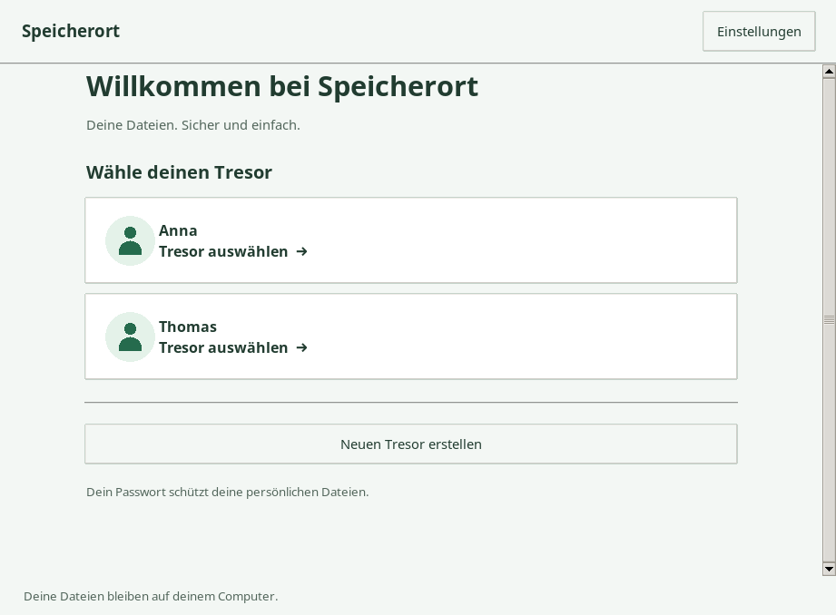
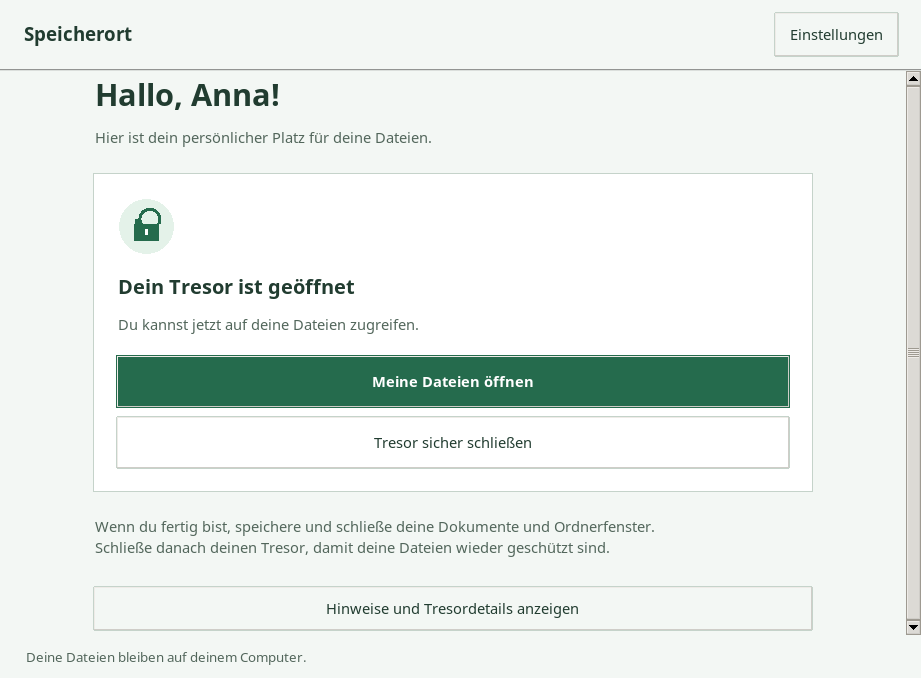

# Prüfbericht: Speicherort 0.3.0

Stand: 16. November 2026. Bestehendes Repository: `Nova91MN/Minttresor`. Entwicklungsbranch: `feat/modern-ui`. Basis vor der Überarbeitung: `2e25095` auf `main`.

## Umgesetzte Oberfläche

- Sichtbarer Name **Speicherort** in Fenstern, Dialogen, Startseite und installiertem Menüeintrag. Interne Paketnamen, Starterpfade und Kontodaten bleiben erhalten.
- Startseite mit großen, per Maus, Tab, Leertaste und Enter bedienbaren Tresorkarten; kein Abtippen des Benutzernamens.
- Eigene Passwortansicht mit automatischem Fokus, Rückweg zur Auswahl und Hauptaktion **Tresor öffnen**.
- Passwortsichtbarkeit nur nach bewusster Auswahl, maximal zehn Sekunden; Verbergen bei Fokuswechsel, Fensterwechsel, Escape und Navigation. Eingabefelder werden vor Hintergrundaktionen und beim Ansichtswechsel geleert.
- Geöffneter Tresor mit **Meine Dateien öffnen**, sekundärem **Tresor sicher schließen** und verständlichem Sicherheitshinweis. Nach dem Schließen bleibt eine eindeutige geschlossene Ansicht mit Aktion zum erneuten Öffnen.
- Vier Schritte zum Erstellen: Name, Passwort mit Wiederholung, Größe/Speicherort, Fertigstellung. Validierung vor jedem Übergang und verständliche Warteanzeige während der Erstellung. Nach der Erstellung wird das Passwort erneut benötigt; anschließend öffnet sich der Dateimanager.
- Einstellungen für den Standardordner; administrative Hinweise erst nach ausdrücklichem Aufklappen. Die Auswahl eines Ordners erteilt keine Systemrechte.
- Deutsche Fehler mit Handlungsempfehlungen. Nur die verlässlich feststellbare lokale Passwortablehnung wird als falsches Passwort bezeichnet. Technische Fehler behaupten keine unbestätigte Ursache.
- Ruhige helle Farben, Mintakzente, große Klickflächen, sichtbarer Fokus und Zustände mit Text und Symbolen. Texte und Schaltflächen umbrechen. Eine scrollbare Seite mit automatischem Nachführen des Tastaturfokus hält Aktionen bei kleinen Fenstern und großer Schrift erreichbar.

## Architektur und Sicherheitsprüfung

Tkinter/ttk bleibt das Framework; keine neuen Laufzeitabhängigkeiten. `ui.py` enthält gemeinsame Stil-, Symbol-, Passwort- und Scroll-Komponenten. `app.py` enthält Navigation und Interaktionen. `core.py` bleibt für Konten und VeraCrypt zuständig. Passwortprüfung, Öffnen, Erstellen, Schließen, Dateimanagerstart und Ordnerspeicherung laufen in einem einzelnen Hintergrundvorgang. Jede Datenbankverbindung wird in ihrem eigenen Thread angelegt und geschlossen; Tk-Änderungen erfolgen nur im Hauptthread über eine Ereigniswarteschlange.

Während eines Vorgangs sind auch verschachtelte Eingaben, Sichtbarkeitsschalter und Navigation gesperrt. Ereignisverarbeitung und Fortschritt bleiben aktiv. Doppelklicks starten keine zweite Aktion. Geplante Fokus- und Passworttimer werden beim Ansichtswechsel bzw. Beenden aufgeräumt.

Unverändert sind die Datenbankstruktur und gespeicherten Pfade, scrypt-Parameter, VeraCrypt-Erstellungsargumente, FAT-Format, Zufallsquelle und Passwortübergabe über stdin. `system/minttresor-helper` und `setup-guests.sh` wurden nicht verändert. Der Helfer bleibt die technische Berechtigungskontrolle. Es gibt keinen neuen privilegierten Codepfad und kein erzwungenes Aushängen.

Fehlertexte reichen keine beliebigen Prozessausgaben weiter. Hintergrundfehler geben keine Tracebacks mit Passwortargumenten aus. Die bisherige CI-Diagnose, die VeraCrypt-Ausgaben im Testhelfer zusätzlich ausgab, wurde entfernt. Bei fehlgeschlagenem Schließen bleibt das Fenster mit seiner geöffneten Sitzung erhalten. Das normale Beenden prüft auch weitere bekannte geöffnete Tresore.

## Geänderte Dateien

| Dateien | Zweck |
| --- | --- |
| `minttresor/app.py` | Vollständige Navigation, Assistent, Hintergrundvorgänge, sichere Sitzungsbeendigung und Fehlerdarstellung |
| `minttresor/ui.py` | Neue wiederverwendbare Oberflächenkomponenten und responsive Gestaltung |
| `minttresor/core.py` | Gemeinsame Namensvalidierung, unterscheidbare Fehlerklassen und gefilterte Prozessfehler; keine Änderung der Verschlüsselung |
| `minttresor/__init__.py` | Version 0.3.0 |
| `install.sh` | Sichtbarer Name im Starter; technische Pfade unverändert |
| `tests/test_core.py`, `tests/test_startup.py` | Erweiterte Regressionen und Fenstername |
| `tests/test_ui.py`, `tests/test_install.py` | Neue GUI-Abläufe, Fehler-, Tastatur-, Thread- und Installationsprüfungen |
| `tests/capture_ui.py` | Reproduzierbare Screenshots mit simuliertem Adapter; Pillow nur optional zur Entwicklung |
| `.github/workflows/tests.yml` | GUI-Suite bei beiden Zielauflösungen; keine Ausgabe interner VeraCrypt-Diagnosen |
| `README.md`, `docs/UX-REPORT.md`, `docs/startseite.png`, `docs/ui/*.png` | Benutzeranleitung, Prüfbericht und aktuelle Screenshots |

## Ausgeführte Prüfungen

Die vollständige Suite wurde lokal unter Xvfb mit Python 3.13/Tk 8.6 ausgeführt. **47 Tests erfolgreich, keine Fehler und keine übersprungenen Tests.** Die Zielauflösungen sind 1920 × 1080 und 1366 × 768. Zusätzlich lief die Suite mit der verfügbaren Python-3.12-/Tk-9-Umgebung; die genaue lokale Ausführung und spätere CI-Ergebnisse sind im Pull Request nachvollziehbar.

| Bereich | Tatsächlich geprüft |
| --- | --- |
| Bestehende Konten | Datenbank erneut öffnen und authentifizieren; Salts, Prüfwerte und Pfade erhalten; Groß-/Kleinschreibung; doppelte Namen |
| Erstellen | Vier Schritte, Bestätigung, ungültige Größe, Rückwege, Abbrechen, Fehlerbehandlung; vorhandene Testdatei bleibt unverändert |
| Backend-Vertrag | Erstellungsparameter unverändert, stdin statt Passwortargument, keine Überschreibung, kein erzwungenes Schließen |
| Anmeldung | Karte auswählen, automatischer Passwortfokus, Enter, falsches Passwort, technischer Öffnungsfehler, erneuter Versuch |
| Arbeit mit Dateien | Start des Adapteraufrufs im Hintergrund; Weiterleitung zum Dateimanager nach erfolgreicher Ersteinrichtung (simuliert) |
| Schließen/Beenden | Fehler hält Sitzung offen; Abbruch der Bestätigung; erfolgreiches Schließen vor Fensterende; weitere geöffnete Tresore verhindern Beenden |
| Hintergrundarbeit | Ereignisschleife bleibt aktiv; Doppelklick, Navigation und Beenden während einer laufenden Aktion starten keine zweite Operation |
| Passwörter | Sichtbarkeits-Timer, Escape, Fokuswechsel, leere Felder nach Navigation und Aktionen; kein Klartext in Kontodaten oder Fehlerausgaben |
| Einstellungen | Neuer Standardordner, unveränderte Pfade vorhandener Tresore, Erhalt geöffneter Sitzung, einklappbare Administratorhinweise |
| Darstellung/Tastatur | Tab, Leertaste, Enter; 40 Zeichen langer Name; schmales Fenster; Fokus-Scrollen bei 100/125/150/200 % Skalierung |
| Start und Installation | Drei Startwege mit tatsächlichem Fenster/Ereignisschleife; verständlicher Fehler ohne Display bzw. bei nicht lesbaren Kontodaten; echter Installer in temporärem Benutzerverzeichnis |
| Systemhelfer | Pfadgrenzen, Eigentümer, Symlinks, Hardlinks, feste Argumente, festgehaltener Dateideskriptor, kein interaktiver sudo-Fallback |

Zusätzlich erfolgreich: Python-Kompilierung, `bash -n install.sh setup-guests.sh` und `git diff --check`. Es werden ausschließlich Quelldateien, Dokumentation und synthetische Screenshots aufgenommen; keine Kontodatenbanken, echten Tresore oder Zugangsdaten.

Die lokale grafische Umgebung ist Debian/Xvfb, kein Linux-Mint-Desktop. Der reale VeraCrypt-Test ist ein separater GitHub-Actions-Job: geprüfte VeraCrypt-Version 1.26.31, eingeschränktes Gastkonto, tatsächliche Erstellung, falsches Passwort ablehnen, Datei schreiben, schließen und erneut lesen. Sein Ergebnis muss anhand des konkreten Workflow-Laufs geprüft werden und wird nicht aus den simulierten GUI-Tests abgeleitet.

## Visuelle Kontrolle

Es wurden jeweils 15 Ansichten in drei Profilen aufgenommen und visuell kontrolliert: **1920 × 1080 bei 100 %**, **1366 × 768 bei 100 %** und **1366 × 768 bei 200 %**. Schrift, Abstände, Umbruch, Hierarchie, Status und Fehlerrückmeldungen wurden geprüft. Bei hoher Skalierung und längeren Seiten werden weitere Inhalte gescrollt; der Tastaturtest prüft die Erreichbarkeit auch der letzten Aktion. Die Übersichten zeigen bewusst jeweils den oberen Seitenbereich. Ein leeres Passwortfeld im Screenshot ist kein echter Anmeldeversuch.

Alle Bilder zeigen die tatsächliche Tkinter-Anwendung mit temporären Testkonten und simulierten Tresoroperationen. Sie belegen die Oberfläche, keine echte Verschlüsselung.

- [Alle Ansichten: 1920 × 1080](ui/final-1920.png)
- [Alle Ansichten: 1366 × 768](ui/final-1366.png)
- [Alle Ansichten: 200 % Skalierung](ui/final-200.png)
- [Einzelaufnahmen](ui/)

## Verbleibende Einschränkungen

- Kein Linux-Mint-Gastdesktop und keine persönlichen Bestandsdateien wurden bereitgestellt. Ein tatsächlicher Öffnungstest mit dem Tresor des Benutzers wurde deshalb nicht durchgeführt; die automatische Kompatibilitätsprüfung verwendet eine vorhandene isolierte Testdatenbank und prüft unveränderte Dateipfade und Parameter.
- Der lokale Container hat keine VeraCrypt-Installation und keine freigegebenen Loop-/FUSE-Geräte. Echtes Ein-/Aushängen wird im separaten CI-Gasttest geprüft, nicht lokal behauptet.
- Ein vollständiger menschlicher Praxistest unter Linux Mint mit dessen Dateimanager, LibreOffice, Systemskalierung und Screenreader/AT-SPI steht aus. Die Screenreader-Unterstützung von Tkinter wird nicht als vollständig geprüft dargestellt.
- Unveränderte Grenzen: keine automatische Sperre oder Erweiterung, FAT-Dateigrößenlimit, keine Passwortzurücksetzung, keine garantierte Sperre nach Absturz/Stromausfall, keine Isolation bereits geöffneter Tresore innerhalb desselben Linux-Kontos.

## Veröffentlichung

Die Veröffentlichung erfolgt auf `feat/modern-ui` im bestehenden Repository, mit Pull Request gegen `main`. Kein Force-Push und keine direkte Änderung des produktiven Hauptbranches. Der konkrete Commit, PR-Link, Pushstatus und das Ergebnis der GitHub-Actions-Prüfungen werden nach erfolgreichem Push im Abschlussbericht und Pull Request genannt.
